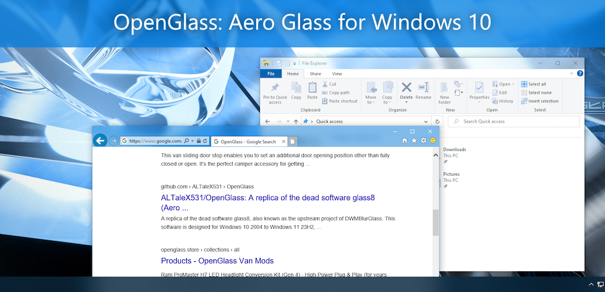

# Experience native look of Aero Glass interface on Windows 10+

This utility returns the full glass effect to the window frame like [glass8](http://www.msfn.org/board/forum/180-aero-glass-for-windows-8/), but with deeper control over blur, reflections, and theme integration.

## Supported Windows versions

- Windows 10 1809-22H2
- Windows 11 21H2-26H2
- Windows Server 2022

> [!IMPORTANT]
> This branch (`legacy`) does **NOT** support Windows 11 26H1 (build 28000+) due to the removal of the legacy MIL compositor. See [#260](https://github.com/ALTaleX531/OpenGlass/issues/260).
>
> For 26H1+ support, switch to the [`milcomp`](https://github.com/ALTaleX531/OpenGlass/tree/milcomp) branch.

> [!NOTE]
> OpenGlass only supports Windows builds from the General Availability channel. Builds from other channels (such as Canary, Dev, Release Preview and Beta) and Windows Server versions other than 2022 are **NOT supported**. Running on unsupported builds can crash DWM.

## Branches

This repository maintains two parallel development lines:

| Branch | Target | Architecture | Status |
|--------|--------|-------------|--------|
| `legacy` (main, aka millegacy) | Windows 10 1809 – Windows 11 25H2 | MIL compositor draw stream hooks | Stable |
| [`milcomp`](https://github.com/ALTaleX531/OpenGlass/tree/milcomp) | Windows 11 26H1+ | Windows.UI.Composition visual hooks | Experimental |

**Key differences**:
- `legacy` relies on the legacy MIL compositor, which was removed in Windows 11 build 28000+.
- `milcomp` bypasses the removed MIL infrastructure by working at the compositor level, supporting builds 28000+.

Choose `milcomp` if you're on Windows 11 26H1 or later. Otherwise, use `legacy`.

> [!CAUTION]
> The `milcomp` branch is experimental and may be unstable. Crashes have been observed in certain scenarios (such as interacting with virtual desktop thumbnails) where the root cause could not be conclusively identified, analysis suggests possible heap corruption originating within DWM itself. Use at your own risk.

## Who should use OpenGlass?

OpenGlass is for advanced users who are comfortable editing the Windows registry and troubleshooting DWM. If you want a simpler option, try [DWMBlurGlass](https://github.com/Maplespe/DWMBlurGlass).

## Quick start

### Getting started

1. **Installation**: Download the latest Inno Setup package from [Releases](https://github.com/ALTaleX531/OpenGlass/releases) and follow the installer.
2. **Configuration**: Use the OpenGlass GUI or edit the [registry](#configuration) directly (manual registry edits require restarting OpenGlass or changing system color settings to apply).
3. **Reference**: Review the release notes and source code to stay informed about behavior changes and technical updates.

> [!TIP]
> **Emergency Exit**: Long press <kbd>Ctrl</kbd>+<kbd>Win</kbd>+<kbd>Shift</kbd>+<kbd>Q</kbd> to immediately terminate DWM if the system becomes unresponsive.

### Reporting issues

If you encounter crashes or technical bugs:

1. **Collect Dumps**: Follow the [WER guidelines](https://learn.microsoft.com/en-us/windows/win32/wer/collecting-user-mode-dumps) to enable user-mode crash dumps if DWM fails.
2. **Submit a Report**: Open a GitHub issue with your **Windows build**, **registry settings**, **steps to reproduce**, and **visual evidence** (screenshots/recordings) if necessary.

## Configuration

**Methods**: Use the OpenGlass GUI for convenience, or edit the registry directly for advanced control.

**Registry locations**:

- `HKEY_CURRENT_USER\SOFTWARE\Microsoft\Windows\DWM` (per-user, checked first)
- `HKEY_LOCAL_MACHINE\SOFTWARE\Microsoft\Windows\DWM` (system-wide fallback)

**Key inheritance**: Missing keys use predefined defaults. Variants (e.g., `XXXInactive`, `XXXMaximized`) inherit from their base key if not explicitly set. Keys with the `Override` suffix take precedence and resist resets by `uxtheme.dll` on Windows 10+.

## Windows Vista Aero

This build renders **Windows Vista Aero and nothing else**. There is no Windows 7 or Windows 8 mode and no
style switches; the values below are fixed (96 DPI values, scaled by the window DPI).

| Area | Behaviour |
| ---- | --------- |
| Corners | Rounded top and bottom, `RoundRectRadius` 8 |
| Frame | Left/right/bottom 8 px (4 sizing + 4 padded), title bar 29 px (8 + 21 caption). Applied by overriding `GetSystemMetricsForDpi` inside `dwm.exe` only |
| Caption buttons | 18 px high. Minimize 26, maximize/restore 25, close 43 (cluster 94), scaled with `MulDiv(value, dpi, 96)` in `CaptionMetricsTweaker::CalculateButtonSize` |
| Glass | Vista blur (sigma 3), color intensity 63%, colorization opacities 100% active / 55% inactive / 75% maximized / 75% inactive maximized |
| Base colors | Transparent `0x00000000`, maximized `0xFF000000`, opaque `0xFFDFDFDF`; the maximized base is preferred for opaque glass (Vista) |
| Maximized windows | Opaque black glass with white caption text |
| Highlights | Vista frame highlights (corner glare hidden on maximized windows, side highlight) |
| Sheen / reflection | `reflection.png` is stretched 1:1 over the whole virtual desktop and fixed in screen space (parallax 0); each frame is a moving viewport onto it. Its alpha runs 75% at the top to 50% at the middle, then 25% to 10% at the bottom |
| Rendering | Direct3D renderer always on |

## Registry reference

The Vista values above are the **defaults**; these registry values still override them (HKCU first, then HKLM).
The Windows 7/8 values (`GlassType`, `HighlightStyle`, `CaptionButtons`, `CenterCaption`,
`ColorizationOpaqueBlendPriority`, the balance/afterglow values, ...) are ignored.

| Key Name | Type | Description |
| -------- | ---- | ----------- |
| ColorizationColor(Override) ColorizationColorInactive | DWORD | ARGB color used for the glass effect, alpha channel is ignored. |
| GlassOpacity GlassOpacityInactive | DWORD | Intensity of the color (0-100%). Default 63%. |
| ColorizationOpacity ColorizationOpacityInactive ColorizationOpacityMaximized ColorizationOpacityInactiveMaximized | DWORD | Factors applied to color blending (0-100%). Defaults 100 / 55 / 75 / 75. `0xFFFFFFFE` or `0xFFFFFFFF` use the default. |
| ColorizationBaseTransparent ColorizationBaseMaximized ColorizationBaseOpaque | DWORD | ARGB base colors. Defaults `0x00000000`, `0xFF000000`, `0xFFDFDFDF`. `0xFFFFFFFE` / `0xFFFFFFFF` use the default. |
| ColorizationOpaqueBlend | DWORD | Controls the transparency of glass effect (default = 0). |
| ColorizationColorCaption ColorizationColorCaptionInactive ColorizationColorCaptionMaximized ColorizationColorCaptionInactiveMaximized | DWORD | Caption text color, 0xBBGGRR. `0xFFFFFFFD` = Vista default (black, `#222222` inactive, white maximized), `0xFFFFFFFE` = from the theme, `0xFFFFFFFF` = system. |
| ColorizationGlassReflectionIntensity ColorizationGlassReflectionOpacity(Inactive/Maximized/InactiveMaximized) ColorizationGlassReflectionParallaxIntensity ColorizationGlassReflectionPolicy | DWORD | Reflection controls. Defaults: intensity 100%, opacity 100 / 25 / 100 / 25, parallax 0%, policy everywhere. |
| BlurDeviation BlurOptimization | DWORD | Blur sigma (default 30 = 3.0) and quality (0 speed, 1 balanced, 2 quality). |
| UseDirect3DRendering | DWORD | Default 1. |
| RoundRectRadius | DWORD | Radius of glass geometry. Default 8, `0` gives square corners. |
| CaptionTextAliasing | DWORD | 0x0 = Windows 7 style ClearType (default), 0x1 = Windows 8 style. |
| TextGlowMode | DWORD | Default 2 (atlas glow, dimmer when inactive). 0 none, 1 atlas, 3 composited. |
| DisableModernBorders | DWORD | Default 0 (Windows 11 only). |
| GlassOverrideAccent | DWORD | Overrides accent blur surfaces with glass (default 0). |
| CustomThemeAtlas / CustomThemeReflection / CustomThemeMaterial / MaterialOpacity | String / DWORD | Custom theme art. |
| DisableGlassOnBattery | DWORD | 1 = opaque glass in energy saver (default), 0 = keep glass. Intended for `HKLM`. |
| DisabledHooks | DWORD | Bit mask of hook modules to disable, see [Shared.hpp](OpenGlass/Shared.hpp). `0x10` turns off the Vista caption button sizes and frame metrics. |
| GlassSafetyZoneMode | DWORD | Set 0 to disable glass safety zone. (default = 1) |

## Credits

### [Banner for OpenGlass](https://github.com/ALTaleX531/OpenGlass/discussions/11)

Provided by [@aubymori](https://github.com/aubymori).
Wallpaper: [metalheart jawn #2](https://www.deviantart.com/kfh83/art/metalheart-jawn-2-1068250045) by [@kfh83](https://github.com/kfh83).

### [[MS-RDPCR2]: Remote Desktop Protocol: Composited Remoting V2](https://learn.microsoft.com/en-us/openspecs/windows_protocols/ms-rdpcr2)

Specifies the Remote Desktop Protocol: Composited Remoting V2, which displays the contents of the Windows-based desktop running on one machine on a second machine connected to the first via a network.

### [KNSoft.SlimDetours](https://github.com/KNSoft/KNSoft.SlimDetours)

SlimDetours is an improved Windows API hooking library base on Microsoft Detours.

### [VC-LTL - An elegant way to compile lighter binaries.](https://github.com/Chuyu-Team/VC-LTL5)

VC-LTL is an open source CRT library based on the MS VCRT that reduce program binary size and say goodbye to Microsoft runtime DLLs, such as msvcr120.dll, api-ms-win-crt-time-l1-1-0.dll and other dependencies.

### [Windows Implementation Libraries (WIL)](https://github.com/Microsoft/wil)

The Windows Implementation Libraries (WIL) is a header-only C++ library created to make life easier for developers on Windows through readable type-safe C++ interfaces for common Windows coding patterns.

### [libvalinet](https://github.com/valinet/libvalinet)

A header-only collection of generic implementations shared between multiple projects.

OpenGlass borrowed its symbol download feature.

### [TranslucentTB](https://github.com/TranslucentTB/TranslucentTB)

A lightweight utility that makes the Windows taskbar translucent/transparent.

OpenGlass borrowed its C++ project structure.

## Development build

### Prerequisites

- **Visual Studio 2026** with C++ desktop development workload
- **vcpkg**: main C++ dependencies (wxwidgets, wil, knsoft-slimdetours) are pulled via vcpkg. Auxiliary packages (VC-LTL, SourceLink) come from NuGet.

### Building

1. Run `vcpkg integrate install` so dependencies are picked up automatically by MSBuild.
2. Open `OpenGlass.slnx` in Visual Studio.
3. Select the `Release` configuration and press `F5`.

> [!TIP]
> **InnoSetup is not required.** You may see errors related to the installer project during build. These do not block compilation and DLLs/executables are still produced.

### ReleaseSigned configuration

Official releases use the `ReleaseSigned` configuration. This configuration uses macros to prevent digital signature from being abused. **Do not mix `ReleaseSigned` binaries with plain `Release` binaries**. Signed and unsigned components are not compatible. If you compile with the plain `Release` configuration, some features may behave differently when loaded alongside official signed DLLs.

## Maintaining offset tables

OpenGlass reads internal `dwmcore.dll` and `uDWM.dll` struct members via hardcoded byte offsets that change between Windows builds. When a new build arrives, these offsets must be updated.

### Automated update (LLM-driven)

Two 7-phase skills methodically extract all offsets from IDA Pro. Each offset struct in the `.Offsets.hpp` files has inline comments documenting the verification function and pseudocode pattern.

**Setup**: Install the [ida-pro-mcp](https://github.com/mrexodia/ida-pro-mcp) MCP server to connect Claude Code to IDA Pro.

1. Open the new DLL in IDA Pro, wait for auto-analysis, then select **Edit** > **Plugins** > **MCP** to activate the plugin
2. Run `/extract-dwmcore-offsets` or `/extract-udwm-offsets` in Claude Code
3. Review the Phase 7 report: verify changed/removed/not-verified offsets against the binary, then either let Claude Code apply the edits or manually update [dwmcoreProjection.Offsets.hpp](OpenGlass/dwmcoreProjection.Offsets.hpp) / [uDwmProjection.Offsets.hpp](OpenGlass/uDwmProjection.Offsets.hpp)

### Manual update

If IDA Pro is not available, locate the accessor functions named in each offset struct's comment (see `.Offsets.hpp` files) using a disassembler, find the member-accessing instructions, and read the displacement bytes.

## Support

OpenGlass is developed in my free time and distributed under the GPLv3 license.

As DWM does not officially support extensibility, OpenGlass relies on undocumented techniques. While designed for stability and performance, future Windows updates may cause breakage. Efforts will be made to maintain functionality, but continuous support cannot be guaranteed.

If you find OpenGlass valuable, please consider supporting the project via Ko-fi. By donating, you agree that:

- Your donation is voluntary without expectation of consideration.
- You donate as a natural person.

